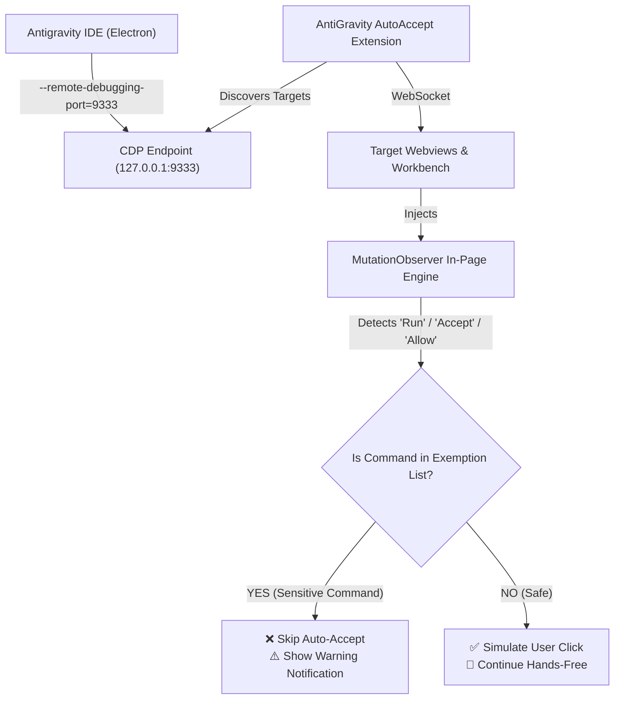

<div align="center">

# ⚡ AntiGravity AutoAccept

**Hands-free agent approvals, terminal execution, and tool permissions for Google Antigravity with built-in command exemption protection.**

[](https://opensource.org/licenses/MIT)
[](https://code.visualstudio.com/)
[](https://nodejs.org/)
[](https://microsoft.com/windows)

[Key Features](#-key-features) • [Installation](#-installation) • [Exemptions & Safety](#-command-exemptions--safety) • [Configuration](#-configuration) • [Architecture](#-how-it-works)

</div>

---

## 🚀 Key Features

* 🤖 **Zero-Click Approvals**: Automatically accepts agent steps, terminal commands, file modifications, and permission dialogs across all conversations.
* 🛡️ **Built-in Safety Blacklist**: Define sensitive command patterns (like `git push --force`, `rm -rf`, or `npm publish`) that are **never** auto-run, prompting for manual confirmation instead.
* ⚡ **Event-Driven via CDP**: Hooks into Chrome DevTools Protocol with an active `MutationObserver`—eliminating polling lag and clicking approval buttons the moment they appear in the DOM.
* 🎛️ **Status Bar Control**: Real-time status indicator (`$(check) AutoAccept: ON`) on the bottom status bar for one-click toggling, status checks, and fast settings management.
* 🔄 **Multi-Agent & Multi-Tab**: Automatically discovers and tracks background agent sessions and webviews simultaneously.
* 📦 **Zero External Runtime Dependencies**: Built entirely on standard VS Code Extension APIs and native Node.js (`fetch` & `WebSocket`).

---

## 📊 Feature Comparison

| Feature | AntiGravity AutoAccept | Manual Approval |
| :--- | :---: | :---: |
| **Terminal & Tool Auto-Run** | ✅ Instant | ❌ Manual Click |
| **File Edit Multi-Step Accept** | ✅ Hands-Free | ❌ Manual Click |
| **Command Exemption Blacklist** | ✅ Configurable | ⚠️ Relies on Memory |
| **Background Agents (Swarm)** | ✅ Automatic | ❌ Must Focus Tab |
| **Cost** | 🆓 **100% Free & Open** | N/A |

---

## 🛠️ How It Works



---

## 📥 Installation & Setup

### 1. Launch Antigravity with Debug Port
To allow the extension to interface with Antigravity's UI, launch it with `--remote-debugging-port=9333`.

We provide an automated launcher that also patches your shortcuts:
```powershell
# Patch your Desktop & Start Menu shortcuts once:
.\launch-antigravity.ps1 -UpdateShortcut
```
*After running this, clicking your desktop shortcut will always launch Antigravity with the debug port enabled.*

### 2. Extension Deployment
The extension is packaged directly into your local extensions folder:
* `%USERPROFILE%\.vscode\extensions\local.antigravity-autoaccept-1.0.0\`
* `%USERPROFILE%\.antigravity\extensions\local.antigravity-autoaccept-1.0.0\`

Press `Ctrl+Shift+P` → `Developer: Reload Window` in Antigravity to activate.

---

## 🛡️ Command Exemptions & Safety

You remain in complete control over what runs on your machine. When an agent proposes a command matching your exemption rules, AutoAccept automatically halts and leaves the button for manual review.

### Default Blocked Patterns
* `rm -rf`
* `del /f`
* `git push`
* `npm publish`
* `format`
* `drop database`

### Adding Custom Exemptions

#### Option A: Via Command Palette
1. Press `Ctrl+Shift+P`.
2. Select **`AutoAccept: Add Exempt Command Pattern`**.
3. Type the keyword or command pattern (e.g. `docker rm -f`).

#### Option B: Via Settings UI
1. Open Settings (`Ctrl+,`).
2. Search for **`antigravityAutoAccept.exemptCommands`**.
3. Add any patterns or keywords you wish to protect.

---

## ⚙️ Configuration Reference

All settings can be customized in your `settings.json`:

```jsonc
{
  // Toggle the entire auto-accept engine on or off
  "antigravityAutoAccept.enabled": true,

  // Remote debugging port
  "antigravityAutoAccept.cdpPort": 9333,

  // Commands that require manual confirmation
  "antigravityAutoAccept.exemptCommands": [
    "rm -rf",
    "del /f",
    "git push",
    "npm publish",
    "format",
    "drop database"
  ],

  // Target button labels to accept
  "antigravityAutoAccept.allowedKeywords": [
    "run",
    "accept",
    "always allow",
    "allow",
    "proceed",
    "continue",
    "confirm",
    "execute"
  ],

  // Reconnection & target discovery polling interval (ms)
  "antigravityAutoAccept.pollIntervalMs": 2000
}
```

---

## ⌨️ Command Palette Actions

| Command | Action |
| :--- | :--- |
| `AutoAccept: Toggle ON / OFF` | Instantly pauses or resumes the auto-accept loop. |
| `AutoAccept: Add Exempt Command Pattern` | Quick input to add a new command blacklist pattern. |
| `AutoAccept: Open Configuration Settings` | Jumps straight to AutoAccept settings. |
| `AutoAccept: Show Status` | Shows active port, connected target count, and active exemptions. |

---

## 📂 Project Structure

```text
├── extension.js           # Core extension activation, CDP controller & observer injector
├── autoaccept.js          # Standalone Node.js CLI daemon (alternative to extension)
├── launch-antigravity.ps1 # Helper script to launch Antigravity & patch shortcuts
├── package.json           # VS Code extension manifest & metadata
└── README.md              # Documentation
```

---

## 📄 License

Distributed under the **MIT License**. See `LICENSE` for details.
